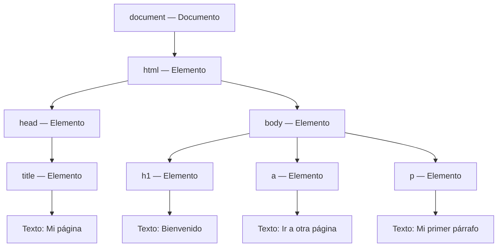

# 03 · El DOM en JavaScript

El **DOM** (Document Object Model) es la representación de una página como un árbol de objetos. Cada elemento HTML se representa mediante un objeto que podemos utilizar desde JavaScript para cambiar su contenido, sus atributos o su estilo, o para añadir y eliminar elementos.

Este README reúne la teoría con ejemplos prácticos.

## Ejemplo 01 Acceder a los elementos del DOM

Archivo: [01_JS_Acceso.html](01_JS_Acceso.html).

### Qué vamos a ver

- Cómo representa el navegador una página mediante un árbol de nodos.
- Cómo localizar un elemento o una colección por id, etiqueta, name, clase o selector CSS.
- Cómo recorrer una colección y consultar propiedades de sus elementos.
- Por qué utilizamos const y cuándo ejecutar las consultas al DOM.

### 1. El árbol de una página

Cuando el navegador interpreta el HTML, crea una estructura de nodos relacionados entre sí. Un nodo puede contener otros nodos: por ejemplo, el body contiene párrafos y cada párrafo puede contener texto.

Por ejemplo, una página con un título, un enlace y un párrafo se puede representar así en el árbol DOM:

Cada flecha conecta un nodo padre con uno de sus hijos. Un nodo puede tener varios hijos, pero solo un padre. Un elemento como `p` contiene un nodo de texto; el elemento y su texto son nodos distintos.

El objeto `document` es la entrada que utilizamos para consultar el documento desde JavaScript. No tenemos que crear los elementos que ya están escritos en el HTML: el navegador los representa como objetos y nosotros podemos obtener sus referencias.

#### Tipos de nodos y atributos

| Tipo | Qué representa |
| --- | --- |
| Document | El documento, raíz del árbol. |
| Element | Un elemento HTML, como un párrafo o un enlace. |
| Text | El texto que contiene un elemento. |
| Comment | Un comentario del HTML. |
| Attr | Un atributo asociado a un elemento, como id o title. Los atributos no son hijos del elemento en el árbol. |

Por ejemplo, en `
Hola
` tenemos un elemento `p`, un atributo `id` y un nodo de texto con el contenido «Hola».

### 2. Obtener un elemento o una colección

Podemos acceder a los nodos del árbol DOM mediante varias técnicas. Algunos métodos devuelven **un solo elemento**. Otros devuelven **una colección**, que puede contener ninguno, uno o varios elementos.

Las colecciones se pueden consultar por posición o recorrer con un bucle. Aunque se parecen a los arrays, **no son arrays**.

| Método | Busca por… | Qué devuelve |
| --- | --- | --- |
| `getElementById()` | Identificador id. | Un elemento, o null si no existe. |
| `getElementsByTagName()` | Nombre de etiqueta. | Una colección HTMLCollection. |
| `getElementsByName()` | Atributo name. | Una colección NodeList. |
| `getElementsByClassName()` | Clase CSS. | Una colección HTMLCollection. |
| `querySelector()` | Selector CSS. | El primer elemento que coincide, o null. |
| `querySelectorAll()` | Selector CSS. | Una colección NodeList con todos los coincidentes. |

Las colecciones tienen posiciones y una propiedad `length`. Para sacar sus elementos, basta con recorrerlas con un bucle.

#### Buscar por id

El id identifica un elemento y debe ser único en el documento:

~~~js
const cabecera = document.getElementById('cabecera');
~~~

En este método escribimos el identificador, si no existe, obtenemos `null`.

#### Buscar por etiqueta

~~~js
const parrafos = document.getElementsByTagName('p');
console.log(parrafos.length); // 3 en el ejemplo 01.
const primerParrafo = parrafos[0];
~~~

La colección contiene los párrafos del documento. La primera posición es **0**, igual que en un array. Si la colección está vacía, `parrafos[0]` es `undefined`.

#### Buscar por name

~~~js
const encontradosPorNombre = document.getElementsByName('parrafo1');
~~~

Busca el atributo `name`, no el `id`: son atributos diferentes, aunque en el ejemplo tengan el mismo valor. El uso de `name` es especialmente habitual en los campos de un formulario.

#### Buscar por clase

~~~js
const principales = document.getElementsByClassName('principal');
~~~

Aquí escribimos la clase **sin punto**. Aunque solo coincida un elemento, el resultado es una colección; accedemos al primero con `principales[0]`.

### 3. Buscar con selectores CSS

Los selectores son los mismos que utilizamos en CSS:

| Selector | Qué selecciona |
| --- | --- |
| `p` | Elementos de tipo párrafo. |
| `.principal` | Elementos con la clase principal. |
| `#cabecera` | El elemento con id cabecera. |
| `p.parrafo2Clase` | Párrafos con la clase parrafo2Clase. |

La diferencia entre los dos métodos es la cantidad de resultados:

~~~js
const primero = document.querySelector('.principal');
const todos = document.querySelectorAll('.principal');

console.log(primero); // Un elemento.
console.log(todos);   // Una colección NodeList.
~~~

Si no hay coincidencias, `querySelector()` devuelve `null` y `querySelectorAll()` devuelve una colección vacía, cuya longitud es 0.

En el ejemplo también buscamos un párrafo concreto combinando etiqueta y clase:

~~~js
const parrafosDeClase = document.querySelectorAll('p.parrafo2Clase');
console.log(parrafosDeClase[0].style.color); // 'red' en este HTML.
~~~

### 3. Recorrer una colección

Con `for...of` podemos recorrer la colección y recibir directamente cada elemento, sin utilizar un índice:

~~~js
const parrafos = document.getElementsByTagName('p');

for (const parrafo of parrafos) {
    // Podríamos consultar o modificar cada párrafo.
}
~~~

En cada vuelta, `parrafo` contiene uno de los elementos de la colección. Por ahora solo mostramos la estructura del recorrido, sin modificar los párrafos. En el ejemplo 02 aprenderemos a establecer su texto con `textContent`.

### 4. Por qué utilizamos const

Normalmente guardamos las referencias del DOM con `const` porque no necesitamos asignarles otro elemento después. Esto **no impide modificar el elemento**:

~~~js
const parrafo = document.getElementById('parrafo1');
parrafo.style.color = 'red'; // Permitido: cambia una propiedad del elemento.
~~~

En el `for...of`, cada vuelta tiene su propia constante `parrafo`. Usamos `let` cuando necesitamos reasignar una variable.

### 5. Consultar propiedades de un elemento

Una vez obtenida la referencia, podemos consultar sus propiedades con un punto:

~~~js
const parrafo = document.getElementById('parrafo1');
console.log(parrafo.id);               // 'parrafo1'
console.log(parrafo.style.fontWeight); // 'bold'
console.log(parrafo.style.color);      // 'blue'

const enlace = document.getElementById('enlace');
console.log(enlace.title); // Texto del atributo title.
console.log(enlace.href);  // Dirección del enlace, expresada como URL absoluta.
~~~

Los resultados de color y grosor corresponden a los estilos escritos en el atributo `style` de ese párrafo. En JavaScript, `font-weight` se escribe `fontWeight` al acceder a esta propiedad.

**`.style` consulta los estilos en línea**, no todos los estilos que se aplican desde CSS. Por ejemplo, el párrafo de clase principal tiene su color definido en una regla CSS: su `style.color` estará vacío aunque se vea coloreado. 

### 6. Acceso automático por id

El navegador también permite acceder a elementos por su id. Por eso en el ejemplo funcionan estas instrucciones sin haber declarado antes una constante enlace:

~~~js
console.log(enlace.title);
console.log(enlace.href);
~~~

Es un comportamiento del navegador que expone elementos mediante propiedades de `window`. Es cómodo en ejemplos pequeños, pero puede haber conflictos de nombres. Para código grandes puede ser preferible guardar una referencia explícita con `getElementById()`.

### 7. Cuándo ejecutar el código

Para localizar un elemento, el navegador debe haberlo creado ya en el DOM. El ejemplo utiliza:

~~~html
<body onload="cargar()">
~~~

El evento `load` ejecuta `cargar()` cuando la página ha terminado de cargar, incluidos los recursos que espera ese evento. De ese modo, los elementos que consultamos ya existen.

Más adelante veremos otras formas de organizar la carga, como `DOMContentLoaded` o un archivo de script externo con `defer`.

### Cómo probar el ejemplo 01

1. Abre el HTML en el navegador, preferiblemente con Live Server.
2. Pulsa F12 y consulta la consola para ver los elementos, colecciones y propiedades.
3. Usa la pestaña Elementos o Inspector para relacionar el HTML con su representación en el DOM.
4. Compara los resultados de seleccionar un elemento y de obtener una colección, aunque esta contenga solo uno.

Los comentarios de cada HTML aclaran las instrucciones concretas.

## Ejemplo 02 Crear y eliminar elementos del DOM

Archivo: [02_JS_Alterar.html](02_JS_Alterar.html).

### Qué vamos a ver

- Crear un elemento con `createElement()`.
- Establecer atributos con `.` y con `setAttribute()`.
- Establecer su texto con `textContent`.
- Añadirlo a la página mediante `appendChild()`.
- Eliminar un elemento con `remove()`.
- Observar los cambios al pulsar un botón.

### 1. Crear un elemento no significa mostrarlo

`document.createElement()` crea un elemento que todavía no está incorporado al árbol de la página:

~~~js
const parrafo = document.createElement('p');
parrafo.id = 'parrafo1';
~~~

Ya tenemos un objeto que representa un párrafo y podemos modificarlo, pero **todavía no aparece en la página**. Asignar el atributo id tampoco lo inserta: necesitamos añadirlo al documento.

Para establecer este atributo podemos asignar la propiedad `id`, como arriba, o utilizar el método `setAttribute()`:

~~~js
// Alternativa a parrafo.id = 'parrafo1':
parrafo.setAttribute('id', 'parrafo1');
~~~

El primer argumento es el nombre del atributo y el segundo es su valor.

### 2. Darle contenido con textContent

~~~js
parrafo.textContent = 'Párrafo creado alterando el árbol DOM';
~~~

`textContent` establece el texto del elemento. En un elemento que ya tenga contenido, lo sustituye. El contenido se trata como texto: si escribimos etiquetas como `<strong>Hola</strong>`, se mostrarán esos caracteres, sin interpretarlos como HTML.

El párrafo preparado equivale a:

~~~html

Párrafo creado alterando el árbol DOM

~~~

En el HTML también se conserva una alternativa comentada:

~~~js
const contenido = document.createTextNode('Párrafo creado alterando el árbol DOM');
parrafo.appendChild(contenido);
~~~

Aquí creamos por separado un nodo de texto y lo añadimos como hijo del párrafo. Para este caso sencillo, utilizamos `textContent` como forma principal. Estas dos opciones son alternativas.

### 3. Añadir el elemento a la página

~~~js
document.body.appendChild(parrafo);
~~~

`appendChild()` añade el nodo al final de los hijos del elemento elegido. En este caso lo añadimos al `body`, y es entonces cuando el párrafo aparece en la página.

La secuencia completa es **crear, preparar y añadir**:

~~~js
const parrafo = document.createElement('p');
parrafo.id = 'parrafo1';
parrafo.textContent = 'Párrafo creado alterando el árbol DOM';
document.body.appendChild(parrafo);
~~~

### 3. Eliminar un elemento

En el ejemplo utilizamos el acceso por id que vimos antes para eliminar el enlace:

~~~js
enlace.remove();
~~~

`remove()` retira el elemento de la página. Es una forma directa de expresar lo que queremos hacer.

También dejamos comentada la alternativa mediante su padre:

~~~js
// enlace.parentNode.removeChild(enlace);
~~~

`parentNode` obtiene el nodo padre del enlace: aquí es el `div` con id `cabecera`. `removeChild(enlace)` le pide a ese padre que elimine el hijo indicado. Las dos formas permiten eliminar el enlace; en el ejemplo usamos la más corta.

### 4. Ejecutar el cambio al pulsar el botón

A diferencia del ejemplo 01, este ejemplo no realiza los cambios al cargar. Así podemos observar primero la página original y después modificarla:

~~~html
<button type="button" id="modificar" onclick="modificar()">Modificar página</button>
~~~

`onclick` llama a `modificar()` cuando pulsamos el botón. La función crea el párrafo, lo incorpora a la página y elimina el enlace.

Después desactivamos el botón:

~~~js
document.getElementById('modificar').disabled = true;
~~~

Esto evita repetir la operación: el enlace ya se ha eliminado y tampoco queremos crear varios párrafos con el mismo id. Para volver al estado inicial del ejemplo, recargamos la página.

### Cómo probar el ejemplo 02

1. Abre la página y comprueba que se ve el enlace y todavía no aparece «Párrafo creado alterando el árbol DOM».
2. Pulsa **Modificar página**.
3. Comprueba que aparece el nuevo párrafo, desaparece el enlace y el botón queda desactivado.
4. Abre el Inspector para localizar el párrafo añadido en el árbol DOM.
5. Recarga para repetir la prueba.

## Ejemplo 03 Leer y utilizar los datos de un formulario

Archivo: [03_JS_Formulario.html](03_JS_Formulario.html).

### Qué vamos a ver

- Leer el valor de un campo.
- Distinguir el identificador `id` del nombre de parámetro `name`.
- Recoger los datos con `FormData`, incluidos radios y casillas.
- Convertirlos a parámetros con `URLSearchParams`.
- Diferenciar una vista previa de parámetros y el envío del formulario.
- Elegir el destino al que se envían los datos del formulario, mediante radios o botones.

El formulario contiene Nombre, Ciudad, Servidor, Asignaturas y Observaciones. 

### 1. Leer un campo con value

La propiedad `.value` obtiene el valor actual del control. En un campo de texto es lo que ha escrito el usuario:

~~~js
const campoNombre = document.getElementById('nombre');
console.log(campoNombre.value);
~~~

Este fragmento muestra cómo consultar un campo individual. En el HTML recogemos los datos del formulario completo con `FormData`.

### 2. Diferencia entre id y name

~~~html
<input type="text" id="nombre" name="nombre">
~~~

Aunque aquí coincidan, cumplen funciones diferentes:

| Atributo | Para qué sirve |
| --- | --- |
| `id` | Identificar un elemento del documento para localizarlo o asociarle una etiqueta. Debe ser único. |
| `name` | Dar nombre al dato que recogerá el formulario. Puede repetirse, como en las asignaturas. |
| `value` | Indicar el valor del control. En los campos editables consultamos su valor actual con `.value`. |

Tener un `id` no basta para que `FormData` recoja un campo: necesita `name`.

### 3. Radios y Checkbox

Podemos elegir el actión con radios y mediante JS. Recordemos que los radios son excluyentes entre si. 

~~~html
<input type="radio" name="servidor" id="servidorA" value="/recursoServidorA" checked>
<input type="radio" name="servidor" id="servidorB" value="/servidorB">
~~~

Antes del envío, `prepararEnvio()` utiliza este código para aplicar el destino seleccionado, en función del radio button seleccionado iremos a un destino u otro:

~~~js
const formulario = document.getElementById('formulario');
const seleccionado = document.querySelector('input[name="servidor"]:checked');
formulario.action = seleccionado.value;
~~~

`:checked` busca el radio marcado. El selector busca input cuyo nombre sea 'servidor' y que este **checked**

Por otro lado, **Asignaturas** comparten `name="asignaturas"`, pero, a diferencia de los radios, las casillas no se excluyen entre sí.

### 4. Recoger los datos con FormData

~~~js
const formulario = document.getElementById('formulario');
const datos = new FormData(formulario);
~~~

`FormData` recoge los datos actuales del formulario como parejas de nombre y valor. No necesitamos recorrer sus controles manualmente.

Para los controles de este ejemplo:

- Recoge los campos que tienen `name`.
- Incluye solo los radios y las casillas marcados.
- Conserva varios valores con el mismo nombre si elegimos varias asignaturas.
- No incluye controles deshabilitados con `disabled`.
- No incluye los botones de envío cuando lo construimos así, sin indicar un botón concreto.
- Muy util para AJAX. 

Si no marcamos ninguna asignatura, no se añade ese parámetro. Un campo de texto vacío con `name` sí se recoge, con un valor vacío.

Por ejemplo, si marcamos Encantamientos y Pociones, se conservan las dos parejas:

~~~text
asignaturas → Encantamientos
asignaturas → Pociones
~~~

**FormData no valida ni envía nada por sí solo.** En este ejemplo se construye al pulsar Ver parámetros para obtener una vista previa de los valores actuales. Usaremos este objeto más adelante con AJAX.

### 5. Convertir los datos a parámetros

`URLSearchParams` permite preparar parejas de nombre y valor para una cadena de consulta. Recibe los datos recogidos y se ocupa de los separadores y la codificación:

~~~js
const parametros = new URLSearchParams(datos);
console.log(parametros.toString());
~~~

`toString()` produce una cadena sin el signo `?` inicial. Por ejemplo, con Ana, New York, Servidor A, dos asignaturas y las observaciones vacías:

~~~text
nombre=Ana&ciudad=New+York&servidor=%2FrecursoServidorA&asignaturas=Encantamientos&asignaturas=Pociones&observaciones=
~~~

El signo `=` separa el nombre de su valor y `&` separa los parámetros. Repetir `asignaturas` conserva las dos selecciones; no se sustituye una por otra.

#### Recorrer y consultar los parámetros

En `verParametros()` también recorremos `parametros` para mostrar cada dato por separado:

~~~js
for (const [nombre, valor] of parametros) {
    console.log(nombre + ': ' + valor);
}
~~~

Cada vuelta recibe una pareja. La escritura `[nombre, valor]` se llama **desestructuración**: guarda el primer componente en `nombre` y el segundo en `valor`.

Por ejemplo, si elegimos Hogsmeade y marcamos Encantamientos y Pociones, entre los resultados veremos:

~~~text
ciudad: Hogsmeade
asignaturas: Encantamientos
asignaturas: Pociones
~~~

Si conocemos el nombre del parámetro, podemos consultarlo sin recorrer todos:

~~~js
console.log(parametros.get('ciudad'));          // 'Hogsmeade' si la hemos seleccionado.
console.log(parametros.getAll('asignaturas')); // ['Encantamientos', 'Pociones'] si marcamos ambas.
~~~

`get()` devuelve el primer valor de ese nombre, o `null` si no existe. `getAll()` devuelve un array con todos sus valores; si no marcamos ninguna asignatura, devuelve `[]`. Para leer todas las asignaturas utilizamos `getAll()`, porque `get()` solo devolvería la primera.

Estas consultas no envían ni modifican los datos: solo permiten leerlos. Muy util si queremos validarlos.

### 6. Espacios y caracteres especiales

Un carácter escrito por el usuario no debe confundirse con los separadores de los parámetros. Por eso los valores se codifican:

| Valor escrito | Parámetro generado por URLSearchParams |
| --- | --- |
| `Ana & Luis` | `nombre=Ana+%26+Luis` |
| `New York` | `ciudad=New+York` |
| `A+B` | `observaciones=A%2BB` |

- `%26` representa el signo `&` que forma parte del valor.
- `URLSearchParams` escribe los espacios como `+`.
- `%2B` representa un signo más literal, para distinguirlo de un espacio.

También puedes encontrar espacios escritos como `%20`. Al leer una cadena de consulta, `URLSearchParams` interpreta tanto `New+York` como `New%20York` como «New York». Esto no significa que `+` represente un espacio en cualquier parte de una URL.

### 7. Qué hace cada botón

| Botón | Qué ocurre al pulsarlo |
| --- | --- |
| Ver parámetros | Recoge los datos con FormData y muestra la cadena en consola. No valida ni envía. |
| Alta | Aplica el destino seleccionado y permite el envío, sin validar los campos. |

Al enviar, el formulario ejecuta `onsubmit="prepararEnvio()"`. La función actualiza `action` y el navegador continúa con el envío normal.

**Alta envía el formulario; Ver parámetros solo muestra sus datos en consola.** No hace falta pulsar Ver parámetros antes de enviar: el navegador prepara los datos automáticamente al pulsar Alta.

El botón Alta también aporta un dato al envío:

~~~html
<input type="submit" name="accion" value="Alta">
~~~

Al pulsarlo, su `name` y su `value` forman el parámetro `accion=Alta`. Esto permite al servidor identificar la acción solicitada.

En cambio, al pulsar Ver parámetros usamos `new FormData(formulario)` sin indicar un botón de envío. Por eso la vista previa recoge los campos, pero no incluye `accion=Alta`.

`method="get"` coloca los parámetros en la URL de destino, después de `?`. `action` cambia a `/recursoServidorA` o `/servidorB` según la opción seleccionada. Son dos rutas ilustrativas dentro del mismo servidor, no dos servidores reales distintos. Para procesar los datos necesitamos un servidor que atienda esas rutas. 

### 8. Elegir el destino con dos botones sin JavaScript

El HTML incluye un segundo formulario independiente para comparar otra opción: cada botón de envío indica su propio destino con `formaction`.

~~~html
<form action="/recursoServidorA" method="get">
    <label for="nombreBotones">Nombre:</label>
    <input type="text" id="nombreBotones" name="nombre">
    <button type="submit" formaction="/recursoServidorA">Enviar al servidor A</button>
    <button type="submit" formaction="/recursoServidorB">Enviar al servidor B</button>
</form>
~~~

El atributo `formaction` del botón pulsado tiene prioridad sobre el `action` del formulario. Los dos botones envían los datos del mismo formulario, pero a rutas distintas.

Este segundo formulario solo contiene su propio campo Nombre: no envía los datos del formulario anterior ni depende de sus radios.

Prueba cada botón y observa la ruta de la barra de direcciones. Ambas rutas requieren un servidor que las atienda.

### Cómo probar el ejemplo 03

1. Abre el HTML con Live Server y la consola con F12.
2. Deja Nombre vacío y pulsa Ver parámetros: aparecerá `nombre=` porque recoger datos no exige que estén completos.
3. Escribe un nombre, elige una ciudad y cambia de servidor.
4. Marca dos asignaturas y pulsa Ver parámetros. Comprueba que aparecen las dos y solo el servidor elegido.
5. Desmarca todas las asignaturas y repite: no debe aparecer el parámetro asignaturas.
6. Prueba «Ana & Luis», «New York» y «A+B» en los campos correspondientes y observa la codificación.
7. Si pruebas Alta, recuerda que este ejemplo no valida los campos y que la ruta de servidor es ilustrativa: la navegación no garantiza que exista una aplicación que procese los datos.

## Ejemplo 04 Generar una tabla a partir de datos

Archivo: [04_JS_TablasDinamicas.html](04_JS_TablasDinamicas.html).

En muchas aplicaciones, la información que mostramos procede de un servidor: productos de una tienda, resultados de una búsqueda o un catálogo de películas. Cuando llegan datos nuevos, podemos querer actualizar solo esa parte de la página, sin volver a cargarla entera ni perder lo que el usuario estaba haciendo.

Por ejemplo, al buscar una película, JavaScript puede solicitar los resultados al servidor y actualizar la tabla que los muestra. La cabecera de la página, los botones y el resto del contenido permanecen en su sitio. Para hacerlo necesitamos dos pasos: **obtener los datos y representarlos en la página**.

En este ejemplo nos centramos en el segundo paso. Las películas ya están disponibles en un array local; no realizamos todavía ninguna petición a un servidor. Aprenderemos a convertir esos datos en una tabla y a sustituir su contenido sin recargar la página. Más adelante, en AJAX, podremos aplicar las mismas técnicas a datos recibidos mediante una petición.

### Qué vamos a ver

- Aplicar arrays, objetos y bucles para mostrar datos en una página.
- Construir una tabla creando elementos del DOM.
- Generar la misma tabla mediante una cadena de HTML e `innerHTML`.
- Sustituir el resultado anterior sin acumular o duplicar tablas.

Este ejemplo combina lo aprendido. La novedad principal es comparar dos formas de generar el mismo contenido. Los dos botones muestran las mismas películas, cada uno en su propio contenedor.

### 1. Los datos y la tabla son cosas distintas

`listarPeliculas()` devuelve un array de objetos. Cada objeto tiene tres propiedades: `titulo`, `director` y `genero`.

~~~js
const pelicula = {
    titulo: 'La vida de Brian',
    director: 'Terry Jones',
    genero: 'Comedia'
};
~~~

Estos datos todavía no son una tabla ni aparecen en pantalla. Las funciones `crearNodosDOM()` y `crearNodosHTML()` leen el array y construyen su representación visual.

En ambas utilizamos `for...of`: cada vuelta recibe una película y genera una fila con sus tres datos.

### 2. Construir la tabla con elementos del DOM

En `crearNodosDOM()` creamos los elementos con `document.createElement()`:

| Elemento | Qué representa |
| --- | --- |
| `table` | La tabla. |
| `tr` | Una fila. |
| `th` | Una celda de cabecera. |
| `td` | Una celda de datos. |

Primero construimos la cabecera con Título, Director y Género. Después creamos una fila para cada película. Este fragmento muestra una de sus celdas:

~~~js
const tr = document.createElement('tr');
const td1 = document.createElement('td');

td1.textContent = pelicula.titulo;
tr.appendChild(td1);
tabla.appendChild(tr);
~~~

El fragmento supone que ya hemos creado `tabla` y estamos dentro del recorrido de películas. En el HTML se crean también las celdas del director y del género.

`textContent` coloca el dato como texto. `appendChild()` establece la relación entre los elementos: la celda pertenece a la fila y la fila pertenece a la tabla.

Al terminar, incorporamos la tabla al contenedor:

~~~js
contenedor.textContent = '';
contenedor.appendChild(tabla);
~~~

La primera línea vacía el resultado anterior. Así, al pulsar otra vez, vemos una tabla nueva en lugar de acumular copias.

### 3. Construir el HTML como texto

En `crearNodosHTML()` no creamos cada celda mediante una llamada a `createElement()`. Escribimos una cadena con las etiquetas de la tabla.

Las plantillas de texto se delimitan con acentos graves y permiten escribir varias líneas. Dentro de ellas, `${...}` inserta el resultado de una expresión:

~~~js
const titulo = 'Los Vengadores';
const celda = `<td>${titulo}</td>`;
console.log(celda); // '<td>Los Vengadores</td>'
~~~

En este momento `celda` sigue siendo texto: todavía no hemos creado un elemento en la página.

En el ejemplo iniciamos la cadena con la tabla y su cabecera. Dentro del bucle añadimos las filas con `+=`:

~~~js
tabla += `
    <tr>
        <td>${pelicula.titulo}</td>
        <td>${pelicula.director}</td>
        <td>${pelicula.genero}</td>
    </tr>`;
~~~

Aquí `tabla` es una cadena, mientras que en la versión DOM era un elemento. Utilizamos `let` porque vamos ampliando esa cadena.

Después añadimos el cierre de la tabla y asignamos el resultado:

~~~js
tabla += '</table>';
contenedor.innerHTML = tabla;
~~~

**`innerHTML` hace que el navegador interprete las etiquetas y cree los elementos correspondientes.** La asignación sustituye el contenido anterior del contenedor, por lo que tampoco acumula tablas al repetir la pulsación.

### 4. Diferencia entre textContent e innerHTML

Con el mismo texto, el resultado es distinto según la propiedad utilizada:

~~~js
contenedor.textContent = '<h2>Hola</h2>';
~~~

Muestra literalmente los caracteres `<h2>Hola</h2>`, incluidas las etiquetas.

~~~js
contenedor.innerHTML = '<h2>Hola</h2>';
~~~

Crea un encabezado de nivel 2 que muestra «Hola». Son dos alternativas para probar por separado: si ejecutamos ambas seguidas, la segunda sustituye el resultado de la primera.

> **Cuidado con `innerHTML`: puede permitir inyecciones HTML** Úsalo únicamente con HTML y datos que controles, como los de este ejemplo, o con contenido correctamente sanitizado (tratado para eliminar etiquetas y atributos peligrosos). No insertes directamente texto de usuarios o fuentes externas; para mostrarlo como texto, utiliza `textContent`. 

### 5. Qué forma elegir

| Forma | Cuándo resulta útil |
| --- | --- |
| Crear elementos y asignar `textContent` | Para insertar los valores como texto y trabajar con cada elemento de forma explícita. |
| Construir HTML y asignar `innerHTML` | Para generar estructuras pequeñas con HTML y datos que controlamos, como los datos fijos de este ejemplo. Nunca de datos directos de usuarios.|

Como punto de partida, preferimos `createElement()` y `textContent` para mostrar texto procedente de usuarios o de fuentes externas: no queremos que sus valores se interpreten como etiquetas HTML.

`innerHTML` es más compacto, pero no debemos introducir directamente contenido no fiable. Interpreta HTML y puede permitir la inserción de contenido peligroso. Las plantillas con `${...}` no escapan automáticamente los valores que insertamos.

Las dos formas son válidas. La primera permite entender la construcción del árbol paso a paso; la segunda ofrece una alternativa más breve para contenido controlado. Tener menos líneas no hace que una solución sea siempre mejor.

### Cómo probar el ejemplo 04

1. Abre la página con Live Server.
2. Pulsa **Crear tabla con DOM**: debe aparecer una cabecera y cuatro filas de películas.
3. Pulsa **Crear tabla con innerHTML** y compara los datos de ambas tablas.
4. Pulsa varias veces cada botón: debe mantenerse una sola tabla en cada contenedor.
5. Inspecciona los elementos del navegador: ambos resultados contienen elementos de tabla, aunque se hayan creado de distinta manera.
6. Como prueba en una copia del ejemplo, añade una película al array y comprueba que aparece al generar cualquiera de las dos tablas.

## Bibliografía

- [MDN Web Docs — Documentación de las APIs web](https://developer.mozilla.org/es/docs/Web/API)
- [JavaScript.info — El documento y el DOM](https://es.javascript.info/document)
