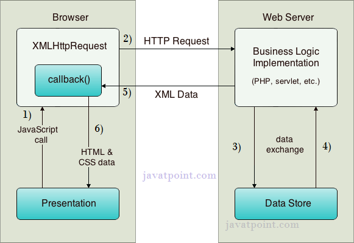

# AJAX y JSON

En este apartado aprenderemos cómo una página puede comunicarse con un servidor y actualizar su contenido sin recargarse por completo. Primero veremos qué es AJAX y cómo funciona, después cómo ejecutar los ejemplos y, finalmente, cómo representar datos con JSON.

## Qué es AJAX

**AJAX es una técnica que permite realizar peticiones HTTP desde JavaScript y utilizar la respuesta para actualizar parte de la página sin cargar un documento nuevo.** Por ejemplo, podemos solicitar una lista de juegos al servidor y mostrarla en una tabla que ya tenemos en pantalla.

Su nombre procede de *Asynchronous JavaScript and XML*. Aunque incluye la palabra XML, también podemos intercambiar JSON, texto u otros formatos. AJAX no es un lenguaje ni una librería que tengamos que instalar.

### Para qué se utiliza

- Buscar juegos y mostrar los resultados sin abandonar la página.
- Actualizar una tabla al cambiar los filtros o solicitar más resultados.
- Enviar un formulario y mostrar la respuesta del servidor en la misma página.
- Consultar información actualizada, como el estado de un pedido.

En los ejemplos de DOM ya construíamos tablas a partir de datos definidos en JavaScript. Con AJAX podemos obtener esos datos de un servidor y después utilizar las mismas técnicas del DOM para mostrarlos.

### Qué significa que sea asíncrono

La respuesta del servidor puede tardar. Al realizar una petición asíncrona, el código que la inicia puede continuar sin esperar a que llegue la respuesta. Cuando esta esté disponible, ejecutaremos el código que la procesa.

Por eso no podemos suponer que los datos ya han llegado justo después de iniciar la petición. Mientras esperamos podemos mostrar un mensaje de carga y, si la petición falla, informar del problema.

## Cómo funciona una llamada AJAX

El dibujo distingue el navegador, a la izquierda, y el servidor, a la derecha. Las flechas muestran el recorrido de la petición y de la respuesta.



Podemos seguir sus números imaginando que el usuario pulsa un botón para buscar juegos.

1. **JavaScript inicia la petición.** Una acción en la página ejecuta nuestro código. En el dibujo se utiliza `XMLHttpRequest` para preparar la comunicación.
2. **El navegador envía una petición HTTP al servidor.** Por ejemplo, solicita los juegos que cumplen los filtros seleccionados.
3. **El servidor procesa la petición.** Su lógica de aplicación puede consultar una base de datos u otro almacén de datos, representado como *Data Store*.
4. **El almacén devuelve los datos al servidor.** El servidor los utiliza para preparar su respuesta.
5. **El servidor responde al navegador.** El dibujo muestra XML, pero también podría devolver JSON o texto. La función indicada como `callback()` procesa la respuesta cuando está disponible.
6. **JavaScript actualiza la página.** Nuestro código utiliza el DOM para mostrar los datos, por ejemplo creando las filas de una tabla. No es necesario recargar el documento completo.

El servidor no tiene que consultar siempre una base de datos. En los primeros ejemplos de este apartado sirve directamente los archivos `fichero.txt`, `musica.xml` y `musica.json`, por lo que no necesitamos los pasos de acceso al almacén de datos.

La flecha final del dibujo menciona HTML y CSS. Esto representa la actualización de la presentación, pero no significa que el servidor deba enviar HTML o CSS. Puede enviar solo datos y nuestro JavaScript decidir cómo mostrarlos.

### Relación con los ejemplos actuales

El dibujo utiliza `XMLHttpRequest`, que aparece en los ejemplos originales conservados en `Antiguo`. Los ejemplos 01, 02 y 03 utilizan `fetch()`, una API integrada en el navegador. La idea sigue siendo solicitar datos, procesar la respuesta y actualizar la página. [MDN explica ambas posibilidades en su introducción a AJAX](https://developer.mozilla.org/en-US/docs/Glossary/AJAX).

Los archivos de datos están agrupados en `ficheros`, que contiene `fichero.txt`, `musica.json` y `musica.xml`. Las copias originales de `Antiguo` se mantienen sin cambios.

## Instrucciones de ejecución

Los ejemplos AJAX deben abrirse a través de un servidor HTTP, en lugar de abrir el HTML directamente como un archivo local. Puedes utilizar Live Server, Apache o Tomcat.

Los ejemplos utilizan rutas relativas a la subcarpeta `ficheros`, como `./ficheros/musica.xml`. No es necesario configurar un puerto en el código. Sirve el HTML y sus recursos desde el mismo origen, utilizando el mismo protocolo, nombre de servidor y puerto.

### Visual Studio Code y Live Server

1. Abre la carpeta raíz del workspace en Visual Studio Code y comprueba que tienes instalada la extensión Live Server.
2. Dentro de `08_AJAX`, pulsa con el botón derecho sobre el HTML y elige **Open with Live Server**.
3. Si Live Server está utilizando el puerto 5500, la dirección del primer ejemplo será `http://localhost:5500/08_AJAX/01_JS_AJAX.html`.
4. Para detenerlo, pulsa el indicador del puerto en la barra inferior de Visual Studio Code.

Live Server sirve los archivos del ejemplo, como `fichero.txt`, `musica.xml` y `musica.json`. No necesitas una base de datos para estas peticiones. Si abres únicamente la carpeta `08_AJAX` como raíz del servidor, la URL ya no incluirá `/08_AJAX/` pero las rutas relativas de estos ejemplos seguirán funcionando.

### Apache

Copia el contenido de `08_AJAX` a una carpeta `JS` dentro de la raíz de documentos de Apache, por ejemplo `htdocs`. Arranca el servidor y abre `http://localhost/JS/01_JS_AJAX.html` si utiliza el puerto 80.

Conserva la subcarpeta `ficheros` con los archivos de datos. Las rutas relativas seguirán funcionando.

### Eclipse y Tomcat

Puedes utilizar un proyecto web llamado `JS` y copiar los ejemplos a su raíz web. Según la estructura del proyecto, puede ser `src/main/webapp` o `WebContent`.

Despliega el proyecto en Tomcat y abre `http://localhost:8080/JS/01_JS_AJAX.html` si el servidor utiliza el puerto 8080 y el contexto es `/JS`. Conserva la subcarpeta `ficheros` dentro del proyecto web.

### Archivos del apartado

| Archivo | Contenido |
| --- | --- |
| [00_JS_JSON.html](00_JS_JSON.html) | Estructuras de datos y conversiones con `JSON.stringify()` y `JSON.parse()`. |
| [01_JS_AJAX.html](01_JS_AJAX.html) | Petición de texto con `fetch()`, `async` y `await`, con mensajes de carga y error. |
| [02_JS_AJAX_JSON.html](02_JS_AJAX_JSON.html) | Lectura de `musica.json` con `fetch()` y creación de una tabla mediante el DOM. |
| [03_JS_AJAX_XML.html](03_JS_AJAX_XML.html) | Lectura de `musica.xml` con `fetch()` y `DOMParser`, creando la tabla mediante el DOM. |

## 01 Primera petición AJAX con fetch

El objetivo sigue siendo solicitar `fichero.txt` al servidor y mostrar su contenido sin recargar la página. El archivo contiene «Hola AJAX!». Conservamos separadas la función que solicita los datos, `cargarInformacion()`, y la que los muestra, `procesarRespuesta()`.

### Iniciar la petición

`fetch()` es una función integrada en el navegador para realizar peticiones HTTP. No requiere instalar una librería. Si no indicamos otro método, utiliza GET.

```js
const respuesta = await fetch('./ficheros/fichero.txt');
```

La ruta es relativa a la página. Por eso el ejemplo funciona con distintos puertos y carpetas mientras se conserve la subcarpeta `ficheros` con el archivo de texto.

### Promesas, async y await

La petición puede tardar y su resultado no está disponible inmediatamente. `fetch()` devuelve una **promesa**, que representa el resultado futuro de una operación. Puede resolverse correctamente o rechazarse si ocurre un error, como un fallo de red.

Declaramos la función con `async` para poder utilizar `await` en su interior. Una función `async` también devuelve una promesa.

`await` pausa la continuación de esa función hasta que la promesa se resuelve o se rechaza. No bloquea toda la página ni convierte la petición en síncrona. El navegador puede seguir atendiendo otras acciones mientras espera.

Por ahora no necesitamos construir promesas manualmente ni aprender todas sus posibilidades. Nos basta con entender que esperamos el resultado antes de utilizarlo.

### Comprobar la respuesta HTTP

La variable `respuesta` contiene un objeto `Response`, con el estado y las cabeceras de la respuesta. Todavía no contiene el cuerpo leído como texto.

| Propiedad | Qué indica |
| --- | --- |
| `respuesta.status` | El código HTTP, por ejemplo 200 o 404 |
| `respuesta.ok` | Si el código está entre 200 y 299 |

Un 404 significa que el servidor ha respondido, pero no ha encontrado el recurso. `fetch()` no rechaza automáticamente la promesa por ese código, de modo que lo comprobamos nosotros.

```js
if (!respuesta.ok) {
    throw new Error(`Error HTTP ${respuesta.status}`);
}
```

`throw new Error(...)` interrumpe el recorrido normal del bloque y permite tratar ese problema en `catch`.

### Leer el texto y actualizar el DOM

Cuando `fetch()` nos entrega la respuesta, el cuerpo aún puede estar llegando. `respuesta.text()` devuelve otra promesa que se resuelve con su contenido completo como cadena. Por eso también utilizamos `await`.

```js
const texto = await respuesta.text();
procesarRespuesta(texto);
```

La función `procesarRespuesta()` asigna el texto a `resultadoBusqueda.textContent`. De esta forma los datos recibidos no se interpretan como etiquetas HTML.

### Gestionar la carga y los errores

Antes de iniciar la petición vaciamos el resultado anterior, mostramos «Cargando...» y desactivamos el botón para evitar peticiones repetidas mientras esperamos.

| Bloque | Qué hacemos |
| --- | --- |
| `try` | Solicitamos el archivo, comprobamos el estado y leemos la respuesta |
| `catch` | Mostramos un mensaje si falla la petición, la comprobación HTTP o la lectura del cuerpo |
| `finally` | Volvemos a activar el botón, tanto si funciona como si falla |

El detalle del error se escribe en la consola. El mensaje de la página se presenta mediante `role="status"`, que permite a los lectores de pantalla anunciar sus cambios sin interrumpir la lectura.

### Relación con el ejemplo anterior

Con `XMLHttpRequest` utilizábamos `open()`, `send()`, eventos como `onload` y la propiedad `responseText`. Con `fetch()` iniciamos la petición directamente y esperamos la respuesta y su texto mediante `await`. No necesitamos consultar `readyState`.

Las variantes antiguas se conservan en `Antiguo/01_JS_AJAX.html`. Allí también está la petición síncrona, que no debemos tomar como modelo porque puede bloquear la página. `fetch()` no ofrece un modo síncrono equivalente.

AJAX permite actualizar solo la parte necesaria y conservar el resto de la interfaz. Requiere JavaScript y no actualiza por sí solo el historial ni la dirección del navegador cuando cambiamos el contenido. Esto no significa que el botón Atrás deje de funcionar, sino que los cambios internos no se convierten automáticamente en nuevas páginas del historial.

**Comprueba el ejemplo.** Ábrelo desde el servidor y pulsa Cargar información. Debe aparecer «Hola AJAX!» y el botón debe quedar disponible de nuevo. Para probar un 404, cambia temporalmente `RECURSO` por un archivo inexistente. Para observar la espera, puedes ralentizar la red desde las herramientas del navegador.

## 02 Cargar JSON y mostrar una tabla

Seguimos los mismos pasos que en el 01, pero solicitamos `./ficheros/musica.json` y leemos el cuerpo con `respuesta.json()` en lugar de `respuesta.text()`.

```js
const respuesta = await fetch(RECURSO);
if (!respuesta.ok) {
    throw new Error(`Error HTTP ${respuesta.status}`);
}
const datos = await respuesta.json();
procesarRespuesta(datos);
```

`respuesta.json()` devuelve una promesa que se resuelve con los datos de JavaScript representados por el texto JSON. Aquí obtenemos un objeto. No necesitamos llamar después a `JSON.parse()`, porque `json()` ya realiza esa interpretación. Si el texto no es JSON válido, el error se trata en `catch`.

### Localizar los discos

El archivo contiene un objeto `CATALOG` cuya propiedad `CD` es un array de discos. Accedemos a él con `datos.CATALOG.CD`. Los nombres distinguen mayúsculas y minúsculas, de modo que respetamos `TITLE` y `ARTIST` tal como aparecen en el archivo.

### Construir las filas

La cabecera de la tabla ya existe en el HTML. `procesarRespuesta()` recorre los discos con `for...of` y utiliza los métodos de tabla que vimos en DOM. `resultadoBusqueda.insertRow()` crea y añade una fila al `tbody`, y `fila.insertCell()` crea y añade cada celda `td`. No necesitamos llamadas adicionales a `append()`.

```js
const fila = resultadoBusqueda.insertRow();
const celdaTitulo = fila.insertCell();
celdaTitulo.textContent = disco.TITLE;
const celdaArtista = fila.insertCell();
celdaArtista.textContent = disco.ARTIST;
```

Asignamos los títulos y artistas con `textContent` para no interpretar los datos como HTML.

Antes de cada petición vaciamos el cuerpo de la tabla para evitar duplicados. Mientras esperamos, desactivamos el botón y mostramos «Cargando...». Si ocurre un error HTTP, de red, de lectura o al procesar los datos, mostramos un aviso y limpiamos cualquier resultado parcial. `finally` vuelve a activar el botón.

**Comprueba el ejemplo.** Carga la música dos veces y observa que no se duplican las filas. Prueba también con una ruta inexistente y, en una copia del archivo de datos, con JSON mal escrito. En ambos casos debe aparecer el aviso y el botón debe quedar disponible.

## 03 Cargar XML con fetch

Este ejemplo es una ampliación para comparar formatos. Reproduce el catálogo de música del 02, pero obtiene los datos de `./ficheros/musica.xml`. La petición y los mensajes de carga y error siguen el mismo esquema.

### Convertir el texto en un documento XML

La respuesta de `fetch()` no tiene un método `xml()` equivalente a `json()`. Primero leemos el cuerpo como texto y después utilizamos `DOMParser`, una herramienta integrada en el navegador.

```js
const texto = await respuesta.text();
const parser = new DOMParser();
const documentoXML = parser.parseFromString(texto, 'application/xml');
```

`parseFromString()` interpreta la cadena como XML y devuelve un documento separado del HTML de la página. No lo muestra automáticamente.

Si el XML está mal formado, el documento devuelto contiene un elemento `parsererror`. No basta con esperar que se lance una excepción, de modo que lo comprobamos expresamente y provocamos un error que recogerá `catch`.

```js
if (documentoXML.querySelector('parsererror') !== null) {
    throw new Error('El archivo no contiene XML bien formado.');
}
```

Esta comprobación detecta errores de sintaxis XML. No garantiza que un documento tenga todas las etiquetas del catálogo que esperamos.

### Leer los discos y mostrarlos

`getElementsByTagName('CD')` obtiene la colección de discos. En cada uno buscamos `TITLE` y `ARTIST` y leemos su `textContent`. Los nombres de las etiquetas distinguen mayúsculas y minúsculas.

```js
const titulo = disco.getElementsByTagName('TITLE')[0].textContent;
```

Después creamos las filas con `insertRow()` y las celdas con `insertCell()`, como en el ejemplo JSON. Solo copiamos el texto de los datos mediante `textContent`, sin insertar los nodos XML en la página.

**Comprueba el ejemplo.** Carga el catálogo varias veces y comprueba que las filas no se duplican. Prueba una ruta inexistente y una copia del XML con una etiqueta sin cerrar. En ambos casos debe aparecer el mensaje de error y el botón debe quedar disponible.

## JSON como formato de intercambio de datos

JSON significa *JavaScript Object Notation*, o notación de objetos de JavaScript. Es un formato de texto para representar datos que podemos guardar en un archivo o intercambiar entre aplicaciones.

Se utiliza habitualmente para intercambiar datos entre el navegador y el servidor. Aunque su nombre hace referencia a JavaScript, también se utiliza desde otros lenguajes.

### Objetos y arrays

Un **objeto** agrupa datos mediante parejas de clave y valor. Se escribe entre llaves, las claves llevan comillas dobles y cada clave se separa de su valor mediante `:`. Las parejas se separan con comas.

```json
{"id": 1, "nombre": "Stark"}
```

Un **array** representa una lista ordenada. Se escribe entre corchetes y sus elementos se separan con comas.

```json
["Juan", "Pedro", "Jacinto"]
```

### Valores permitidos

| Tipo | Ejemplo |
| --- | --- |
| Número | `123.456` o `-10` |
| Cadena de texto | `"Hola"` |
| Booleano | `true` o `false` |
| Valor nulo | `null` |
| Array | `[1, 2, 3]` |
| Objeto | `{"nombre": "Ana"}` |

Los objetos y arrays pueden contener otros objetos o arrays. Un documento JSON también puede representar un valor sencillo, como un número o una cadena, aunque en estos ejemplos trabajaremos principalmente con objetos y listas.

### Reglas que conviene recordar

- Las claves y los textos se escriben con comillas dobles.
- No se añade una coma después del último elemento.
- JSON no admite comentarios, funciones ni `undefined`.
- Los decimales se escriben con punto. `NaN` e `Infinity` no son valores JSON válidos.

### JSON y los objetos de JavaScript

Un objeto JavaScript está en la memoria del programa. JSON es la representación de datos como texto. Aunque su sintaxis se parezca, conviene distinguir ambos conceptos.

```js
const persona = { nombre: 'Ana', edad: 25 };
const texto = JSON.stringify(persona);
console.log(texto); // {"nombre":"Ana","edad":25}

const personaRecuperada = JSON.parse(texto);
console.log(personaRecuperada.nombre); // Ana
```

`JSON.stringify()` convierte el objeto en texto JSON. `JSON.parse()` interpreta el texto JSON y devuelve el valor representado, que aquí es un objeto. Si el texto no es JSON válido, `JSON.parse()` produce un error.

### Ejemplos de JSON

Los siguientes ejemplos muestran distintas formas de organizar datos en JSON.

#### Objeto sencillo
```json
{
  "latitude": 40.416875
}
```

#### Objeto complejo
```json
{
  "latitude": 40.416875,
  "longitude": -3.703308,
  "city": "Madrid",
  "description": "Puerta del Sol",
  "cp": null,
  "moviendose": true
}
```

#### Array simple
```json
[
  0,
  1,
  1,
  2,
  3,
  5,
  8,
  13
]
```


```json
[
  true,
  false
]
```


```json
[
  1,
  1,
  null,
  "steve"
]
```

#### Objeto complejo con array
```json
{
  "latitude": 40.416875,
  "longitude": -3.703308,
  "city": "Madrid",
  "description": "Puerta del Sol",
  "cp": null,
  "moviendose": true,
  "puntos recorridos": [
    23,
    45,
    67,
    89
  ]
}
```

#### Array de objetos
```json
[
  {
    "latitude": 40.416875,
    "longitude": -3.703308,
    "city": "Madrid",
    "description": "Puerta del Sol"
  },
  {
    "latitude": 40.417438,
    "longitude": -3.693363,
    "city": "Madrid",
    "description": "Paseo del Prado"
  },
  {
    "latitude": 40.407015,
    "longitude": -3.691163,
    "city": "Madrid",
    "description": "Estación de Atocha"
  }
]
```

#### Objeto con array
```json
{
  "numeros de fibonacci": [
    0,
    1,
    1,
    2,
    3,
    5,
    8,
    13
  ]
}
```

#### Objeto con array de objetos
```json
{
  "marcadores": [
    {
      "latitude": 40.416875,
      "longitude": -3.703308,
      "city": "Madrid",
      "description": "Puerta del Sol"
    },
    {
      "latitude": 40.417438,
      "longitude": -3.693363,
      "city": "Madrid",
      "description": "Paseo del Prado"
    },
    {
      "latitude": 40.407015,
      "longitude": -3.691163,
      "city": "Madrid",
      "description": "Estación de Atocha"
    }
  ]
}
```

#### Ejemplo más completo con objetos y arrays

```json
{
  "persona": {
    "id": "1",
    "nombre": "Tony",
    "apellido": "Stark",
    "edad": 45,
    "direcciones": [
      {
        "direccion1": {
          "tipoVia": "Plaza",
          "nombreVia": "Plaza de España",
          "pais": "España"
        }
      },
      {
        "direccion2": {
          "tipoVia": "Calle",
          "nombreVia": "Gran Via",
          "pais": "España"
        }
      }
    ],
    "estaCasado": false,
    "pareja": null,
    "superpoder": {
      "superinteligencia": 100,
      "superfuerza": 50
    }
  }
}
```

Son ejemplos, pero tenemos infinitas combinaciones entre ellos.

### Herramientas de conversión entre XML y JSON

- [https://www.site24x7.com/es/tools/json-a-xml.html](https://www.site24x7.com/es/tools/json-a-xml.html)

- [https://www.freeformatter.com/xml-to-json-converter.html](https://www.freeformatter.com/xml-to-json-converter.html)

## Documentación de consulta

- [MDN — DOMParser y parseFromString](https://developer.mozilla.org/en-US/docs/Web/API/DOMParser/parseFromString)

- [JSON.org — Introducción a JSON](https://www.json.org/json-es.html)
- [MDN — Peticiones síncronas y asíncronas](https://developer.mozilla.org/en-US/docs/Web/API/XMLHttpRequest_API/Synchronous_and_Asynchronous_Requests)
